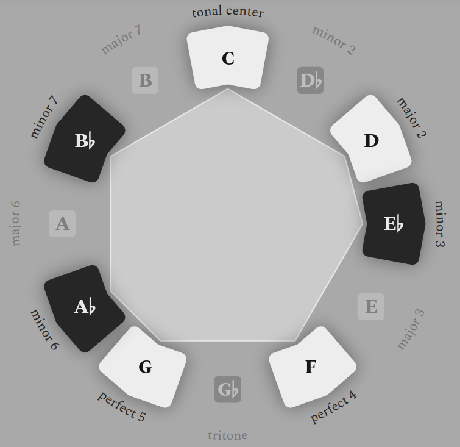
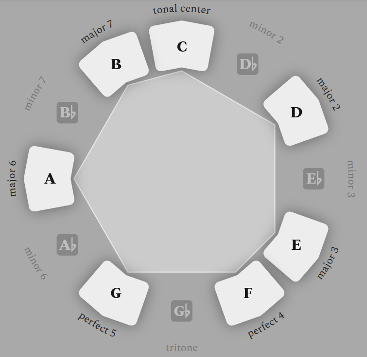

Use this workspace to build a small self contained web based tutorial for users to analyze a song and learn a little about music theory. It should be titled **How to analyze a song's chord progression**.

## Audience

The audience should be adults who are somewhat familiar with music, but may not have a firm grasp on music theory.

## Architecture, build, deployment, and browser target

- Use client-side routing
- Use the static export
- Make it easy to deploy to Vercel
- Don't rely on any web APIs that are not widely supported across modern browsers in 2026.
- Every interaction should be equally usable with a mouse and with a touch device.
- Use fluid width and smart sizing to support a variety of viewport widths and heights. But optimize the page layout for a tablet-sized screen in landscape mode. We do not need to support portrait mode.
- It's okay to hard code as much logic as you want in this app because it will be single use. 

## Sample song

In the root of this workspace there is `count-on-me.wav` which is an excerpt from the song "Count on Me" by Bruno Mars. I have edited this audio so that it can seamlessly play in a loop. Organize this file into a better location within this workspace. We will be serving it to the user. 

It's tabs are as follows:

```
        C                Em
You can count on me like one, two, three
      Am      G
I'll be there
    F
And I know when I need it
      C                 Em
I can count on you like four, three, two
           Am       G
And you'll be there
       F
'Cause that's what friends are s'posed to do
   C
Oh yeah
```

That sequence of chords is:

C Em Am G F C Em Am F C

This is essentially the heart of the "final answer" that we're helping the user determine.

## Other audio samples

- We also need samples of one octave of piano keys. The quality does not need to be high. Figure out how to obtain these. You can either pull in a third party library or figure out a way to commit the assets directly to this repo. If you have any problems obtaining such samples, then stop and let me know so we can reconsider our approach.

- For positive and negative feedback, I would like to use audio samples that sound fun and gamified. Find these and implement them throughout.

## Preloading assets

Before any of the pages load, we need to make sure that we have fetched all of the audio content, including the sample song, and piano samples too. Before rendering page content, show a loading spinner while loading these assets.

## Sample song timeline

Most pages features a scrubbable audio time of the sample song. Load the sample song into memory and use the Web Audio API to loop the song on the audio timeline with gapless playback. The user should be able to drag the timeline marker to scrub across the timeline and there should be a play/pause toggle button to control playback. The timeline should always loop automatically. The user should not be able to disable looping. The timeline should also give attribution to the song name and artist somewhere with low visual prominence. 

## Routing

- Use one route per step.
- In addition to one route per step, there should also be a home route at the site route which introduces the app. 
- Every page should have a "Start over" link which takes the user back to the very beginning, completely resetting the tutorial.

## Steps

On every page except the home page, the app should have persistent UI in a column at the right side of the page which displays the user's position in the following sequence of steps:

1. Tonal center
1. Scale
1. Available chords
1. Chord progression

In each of these steps, we will prompt the user to ask a question and the user must answer it correctly before moving to the next step.

The answers are as follows:

- Tonal center: "C"
- Scale: "Major"
- Available chords: "C Dm Em F G Am"
- Chord progression: "C Em Am G F C Em Am F C"

Within this persistent navigation UI, each step should display the correct answer for all previous steps. And if the user has answered the current step correctly, then that answer should also display in the navigation UI. (The user will need to click "Next" before proceeding to the next step, even after answering the current step correctly.)

No state is to be shared across steps. We assume that if the user is on step three, they have already answered steps one and two correctly.

## Pages

### Home

This should have a title, a one or two sentence introduction, and a interactive scrubbable audio timeline playing the sample song on a loop.

Below the audio timeline, the app should feature a begin button, but the button should be hidden until the user has played the audio in the timeline. Below the timeline there should be a queue instructing the user to interact with the timeline before proceeding.

Once the user clicks begin, the site should navigate to the next page using client-side navigation. 

### Tonal center

In this step, we expect the user to play the sample song and simultaneously interact with a small piano keyboard to determine the tonal center of the song.

Give some text describing the tonal center and how to identify it. Say that it's also called the "tonic".

Below the text, display the sample music timeline.

Below the timeline, leave some empty space that will get filled in with a "decision-maker UI" after the user further interacts with the page.

Below the hidden decision-maker UI, display the piano keyboard.

The piano keyboard should behave as follows:

- It should have a single octave with the lowest note being middle C and the highest note being B above middle C.
- The keys should have round corners on the bottom but not the top.
- Each key should display the name of the note. Use flats to name black notes.
- The key should light up somehow when pressed.
- The keyboard should be multi-touch.
- It should support glissando via dragging mouse and touch.
- There should be no gaps between the click targets of each key.
- Each key should play sound when pressed and stop playing sound when released, using a short and realistic release amplitude envelope.
- When the user presses a key on the piano keyboard, a bubble with the key's note name should animate up from the key and into the decision-maker UI. The first key press should unhide the decision maker UI.

The decision maker UI should function as follows:

- It should have three boxes: a box on the left labeled "No", a box in the middle labeled "Maybe", and a box on the right labeled "Yes".
- Every time the user presses a key on the piano keyboard, if that note is not yet placed in the decision maker UI, it should animate from the key into the middle "Maybe" box.
- When notes are in the boxes, the user can click on them to play the sound and they can also drag to rearrange them. The sound should play while the user is dragging. The sound should stop when the user releases their drag.
- Once the user drags a note into the Yes box, that counts as them submitting an answer. If they drag the correct note ("C") into the yes box then they can advance to the next step. Every time the user submits an answer, the application should give them feedback on their answer indicating whether it is correct or incorrect. The feedback should be gentle and helpful and cheerful and fun. 

### Scale

This page should have the following instructional text:

> Let's figure out what scale this song is in!
> 
> A scale is a way of narrowing down the twelve possible notes to a smaller set — usually seven — which are featured in the song. Each scale is defined by its pattern of "intervals" (i.e. the number of steps between consecutive notes in the scale). We can visualize a scale as a polygon within the circle of all notes.
> 
> There are hundreds of different musical scales, but we'll look at the two most common: "major" and "minor". Try each of these scales out, to see which notes it enables. With each scale, try playing the thirds while listening to the song. Does it sound like this song has a minor third (E♭) or a major third (E)? **Choose this scale that fits the song.**

Below the instructional text we should have the sample music timeline.

Below the sample music timeline, we should have a "Scale picker"

The scale-picker should function as follows:

- See the following attached mockups which I'll use as a basis for describing the scale picker:

      - 

      - 

      Note that these mockups are by no means pixel perfect representations of my intentions here. They are actually taken from another app that I built. I don't necessarily want to preserve any of the visual style, but these mock ups do give you a sense of the shape that I am aiming for, and they provide a basis for further description.  

- As shown in the mockups, we should display a circular keyboard with the tonal center (C) at the top of the circle.
- Use circles as keys instead of the weird key shape shown in the mock up.
- The keys on this keyboard should be playable just like the keys in the piano keyboard on the previous step. 
- Below the circular keyboard the user should have two buttons labeled "Try minor" and "Try major".
- Initially, when this step loads, no scale should be selected, and all 12 notes on the keyboard should be enabled and playable. In this state there should not be any polygon in the middle of the keyboard.
- When the user clicks one of the buttons to try one of the scales, that scale should get placed "inside" the keyboard, enabling only the notes present in the scale, and displaying the polygon.
- Inside the scale polygon there should be a button labeled "Choose minor" or "Choose major". This is the means for the user to submit their answer to this step. Again, we should provide feedback on their answer and only allow them to progress to the next step once they have selected the correct answer.
- Positive feedback should include:

      > Yes the scale is major! With the tonal center of "C" and the scale of "major", now we can say that this song is in the **key** of **C major**.

### Available chords

- Don't render the sample music timeline on this page, because we won't use it.

- Display the following instructional text. 

      > Let's find the chords within the C major scale!
      >
      > A chord is set of notes played together. Different types of chords are defined by their relative pattern of musical intervals, meaning we can visualize chords as polygons in the circle of notes too! Try rotating the major and minor chords within the scale to see where they fit. **Choose all the chords within the scale.**

- Below the instructional text, display a chord identifier. This will function in a similar manner to the scale picker, with the following differences:
      - The user should be able to select either a major or minor chord to display within the scale. By default no cord should be displayed. 
      - The scale polygon should display at all times, and the chord polygon should display on top of the scale polygon.
      - The root position of the chord should have a red dot.
      - The user should be able to drag to rotate the cord within the scale. The rotation should have detents to click it into place at each of the notes within the scale. If the user tries to release the cord between two of the detents, then it should quickly animate to the nearest detent to come to rest.
      - In the middle of the chord polygon there should be a button like "Choose C" or "Choose Em" for the user to submit their answers.

### chord progression

- In this step, the sample music timeline should have 10 regions to represent the sequence of 10 chords within the song excerpt.
- We will need to encode the position of these regions somewhere in our source code and it's fine to hard code these region positions. But we do need to determine the regions somehow, and I would like you to take a stab at determining themselves using spectral analysis of the source audio. If you can't figure it out, that's okay — I can do it myself. But give it a shot.
- Below the timeline, we should have six chord bubbles which the user can drag to copy into segments of the song. Clicking and dragging on a chord bubble should play the chord. Dragging a cord into its slot in the timeline should give the user feedback on whether they are correct or incorrect.
- When the user has reached the very end with all the correct answers we should display something celebratory. 

## Visual Design

- Make it look pretty, polished, inviting, and visually appealing! Give it some color. Keep thee mood fun, light and upbeat.


